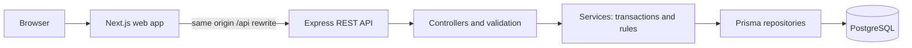
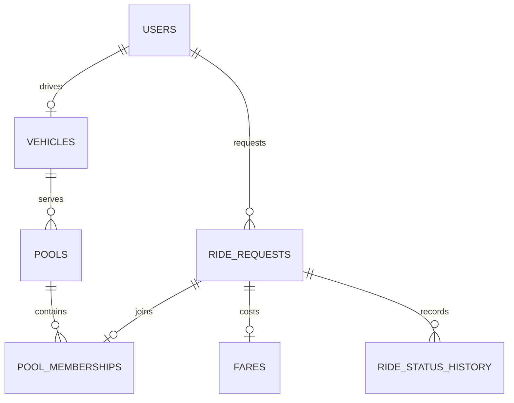

# Dhaka Tesla Pool

An MVP for sharing seats in Dhaka's battery powered three wheelers. Passengers request rides along predefined corridors; the API matches compatible requests into a fixed capacity vehicle, tracks the trip, and calculates each passenger's fare in integer poysha. Drivers manage availability and the trip lifecycle.

## What is implemented

- Passenger and driver registration, sign in, and signed HTTP only cookie sessions.
- Driver vehicle registration with immutable physical capacity, online/offline control, a live pool manifest, and trip history.
- Passenger fare estimates, ride requests, deterministic matching, ride history, cancellation, and status history.
- Driver arrival, start, and completion actions with guarded state transitions.
- PostgreSQL row locking for seat allocation, a partial unique index for one active pool per vehicle, and integer fare constraints.
- Demo seed accounts for Jashim, Nusrat, Rafiq, Shirin, and Ashik.

## Architecture





The service layer owns all transaction boundaries. A join locks the target pool row, checks capacity, inserts a membership, increments `occupied_seats`, transitions the ride, and reprices members in one transaction. Vehicle capacity cannot change after creation. A new pool locks its vehicle row before checking whether another active pool exists. The database also has a partial unique index for that rule. The pool counter must equal the sum of its active memberships after every commit.

Drivers opt into dispatch by going online. Matching then assigns compatible requests automatically; there is no separate acceptance step in this MVP. This avoids holding a seat through an unconfirmed driver action, and the driver still controls departure through arrival and start actions.

## Stack and choices

- **Next.js and React:** Next.js provides routes and a simple same origin API rewrite. Plain React with a router would be enough if server features were unnecessary; switch if the app becomes a purely static client.
- **Express and REST:** Thin HTTP handlers keep validation separate from domain services. Fastify or NestJS would fit a larger API; switch if the team needs their conventions or plugin ecosystem.
- **PostgreSQL and Prisma:** PostgreSQL gives row locks, transactions, constraints, and partial indexes needed for seat safety. Prisma keeps ordinary queries and migrations readable, with a parameterized raw query for `FOR UPDATE`. A different ORM would be reasonable if it offered clearer transaction support; a document database is a poor fit for this relational MVP.
- **Signed cookies and bcrypt:** The browser never needs to handle a bearer token. A managed identity provider would make sense if account recovery, multi device sessions, or external identities became necessary.
- **Vitest and Supertest:** Unit tests cover fare and route rules. A database backed HTTP test covers the last seat race and ownership when a dedicated test database is available.
- **Docker Compose:** Runs the web app, API, and PostgreSQL with health checks on one host. Managed hosting becomes relevant when public deployment is required; no paid service is needed for local evaluation.

Fares use a 1,500 poysha boarding fee plus a fixed distance fee per supported route. Each passenger's route is priced independently. When at least two ride requests share a pool, each receives a 20% discount calculated with integer division. If a passenger cancels before arrival, remaining fares are recalculated. There is no real payment gateway; cash settlement remains `UNPAID` in this MVP.

## Run with Docker

Prerequisites: Docker with Compose.

1. Copy `.env.example` to `.env`.
2. Set `DB_PASSWORD`, `SESSION_SECRET` (at least 32 characters), and `DEMO_PASSWORD` (at least 10 characters) to your own local values. Keep the file untracked.
3. Run `docker compose up --build`.
4. Open <http://localhost:3000>.

The API container applies the checked in Prisma migration and seeds the demo accounts on startup. Seed accounts are idempotent. The API health endpoint is `/health` inside the API container. The web container waits until the API health check passes.

Demo sign in phone numbers are `+8801711000000` for Jashim, `+8801711000001` for Nusrat, `+8801711000002` for Rafiq, `+8801711000003` for Shirin, and `+8801711000004` for Ashik. Their password is the `DEMO_PASSWORD` you set. Jashim's Bullet starts online with three passenger seats.

For the demo, sign in as Nusrat and request Banani to Mohakhali, then as Rafiq and request Banani to Gulshan 1. Both join Bullet. Shirin and Ashik can then race for the last seat. Jashim can mark arrival, start, and complete the pool. A passenger can cancel while `REQUESTED` or `MATCHED`.

## Run without Docker

Install Node.js 22 or newer and PostgreSQL 16 or newer. Create a local database, copy `.env.example` to `.env`, set `DATABASE_URL` to that database, and set the three secrets noted above. Export those values in your shell, then run:

```text
npm ci
npm run db:generate -w @dtp/api
npm run db:migrate -w @dtp/api
npm run db:seed -w @dtp/api
npm run dev:api
npm run dev:web
```

Run the two `dev` commands in separate terminals. The Next.js rewrite sends `/api/*` to `API_INTERNAL_URL` (default `http://localhost:4000`).

## Verification

```text
npm run typecheck
npm run lint
npm run test -w @dtp/api
npm run build
```

The PostgreSQL concurrency test requires a dedicated database whose name ends in `_test`. Set `TEST_DATABASE_URL` and apply the migration to that database before running the tests. The test is skipped when this variable is absent. Never point it at a production database.

## API overview

- `POST /auth/register`, `POST /auth/login`, `POST /auth/logout`, `GET /auth/me`
- `POST /rides/quote`, `POST /rides`, `GET /rides`, `GET /rides/:id`, `POST /rides/:id/cancel`
- `GET /vehicles/me`, `POST /vehicles/status`
- `GET /driver/rides`, `POST /driver/rides/:id/arrive`, `/start`, `/complete`
- `GET /driver/history`

See [API details](docs/api.md), [pool rules](docs/pooling.md), [database design](docs/database.md), and [architecture decisions](.ai/decisions.md).

## Project structure

- `apps/api/src/domain.ts`: corridor, fare, and state transition rules.
- `apps/api/src/services/`: ride and driver workflows with transaction boundaries.
- `apps/api/src/repositories.ts`: row locks and state persistence helpers.
- `apps/api/prisma/`: schema, migration, and demo seed.
- `apps/web/app/`: passenger and driver interfaces.
- `docs/` and `.ai/`: product and architecture notes.

## Limitations and next steps

The route graph is deliberately small, and pending rides do not automatically rematch when a seat becomes available. A passenger can submit a new request to try again. Fare discount changes when another member joins or cancels before arrival. Cash payment collection is not recorded as paid. There is no public deployment, screenshot gallery, or demo video in this repository yet; those submission materials need to be produced from a running instance.

At larger scale, candidate lookup would need indexed geospatial or corridor partitioning, controlled retry for contention, idempotent booking requests, rate limits, metrics, and background matching of pending rides. Add these when load measurements justify them, while preserving the single database authority for seat allocation.

## AI usage

Codex assisted with reading the brief, planning, implementation, and test authoring. An accepted suggestion was the PostgreSQL pool row lock combined with a membership counter updated in the same transaction. A changed suggestion was to lock both pool and vehicle rows on every join: this implementation keeps capacity immutable and locks the pool for joins, while locking the vehicle when creating a new pool. All generated code remains subject to review and demonstration by the candidate.

The internship submission still needs a recorded video of at most six minutes, linked here after recording, with the problem, architecture and ERD, passenger and driver flows, pooling, fare, and one edge case.
